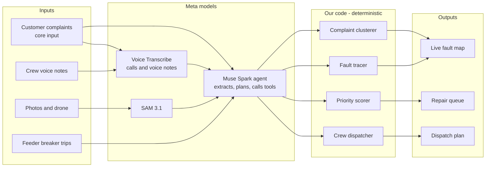

# Relight: Project Brief and Build Plan

> Working title was GridMedic; renamed Relight on 30 Oct 2026 to keep it distinct from the earlier Jaseci-hackathon project of that name.

29 Oct 2026 · Malitha

## Pitch and scope

Relight is an outage-triage agent: when a storm hits, it turns a flood of customer complaints (calls, WhatsApp, SMS), feeder breaker trips, crew voice notes and damage photos into located faults on the grid, and tells dispatch who to send where first.

- **Theme:** Push the Frontier (energy; understanding and controlling a physical system).
- **Track:** Indie. All code is new from Oct 26. The earlier Jaseci-hackathon GridMedic is a reference for the idea only: no reused code, built solo.
- **Core input:** customer complaints. Most of the world's utilities have few or no smart meters (US ~72%, Latin America ~10%, and lower still across much of Asia and Africa), so complaints are how outages are found. Smart-meter data is an optional extra signal.
- **The gap we own:** existing utility AI works from SCADA and smart-meter data or only handles customer comms. Relight turns messy, multilingual complaints and field reports into fault locations on the grid model.

### Must ship

- [ ] Scenario replay that streams storm events into the app in real time
- [ ] Complaint intake: voice calls and text in any language to structured reports (address, symptom, hazard)
- [ ] Complaint deduplication and junk filtering
- [ ] Complaint clustering by service transformer, traced upstream to the likely failed device
- [ ] Crew voice notes to structured damage reports
- [ ] Damage photos and one drone clip analysed with SAM 3.1
- [ ] Ranked repair queue and crew dispatch plan
- [ ] Live map UI with fault confidence rising as complaints arrive, and a 2–3 minute demo video

### Stretch

- [ ] Offline mode on Muse Glimmer (open weights) for when the network is down
- [ ] Smart-meter toggle: last-gasp messages as an extra signal where meters exist
- [ ] Restoration-time estimates per fault, sent back to complaining customers

**Out of scope:** real SCADA or call-centre integration, real utility or customer data, a mobile crew app, user accounts.

## The hackathon at a glance

Meta Global AI Developer Hackathon 2026, run by Meta and Cerebral Valley: virtual, 10 days, $1M prize pool. Event page: <https://cerebralvalley.ai/e/meta-ai-developer-hackathon>. Relight is entered in the Indie track.

| Item | Detail |
|---|---|
| Build window | Oct 26 – Nov 4, 2026 |
| Submission deadline | Nov 4, 9:00 PM ET = Thu Nov 5, 7:30 AM Sri Lanka time |
| Judging · finals · bonus prizes | Nov 4–8 · Nov 9 (live finals) · on or about Nov 10 |
| Indie track prizes (1st–5th) | $150k / $100k / $75k / $50k / $25k ($400k total) |
| Startup track prizes (1st–5th) | $250k / $150k / $75k / $50k / $25k ($550k total) |
| Bonus prizes | Up to $50k (e.g. community vote, most viral) |
| Credits | $150 Meta Model API per participant; some get Baseten $100, Modal $100, Fireworks $25 |
| Ownership | You keep IP; organisers get a perpetual, royalty-free licence to use the submission; nothing shared is confidential |

### Rules that shape the build

- **New work only:** everything presented must be built during the event and this must be clear in the submission. Only the Startup track may build on existing products. Relight (Indie) is a fresh codebase; the earlier Jaseci-hackathon team version is not reused.
- **One track** per person and per project.
- **Must use Meta's models:** Muse Spark series, Muse Wonder, Muse Image, Muse Voice Transcribe and SAM 3.1 via Meta Model API; open weights Muse Glimmer and Muse Spark Open; Muse Code coding agent.
- **Must fit a problem statement:** *Build for Your World* (bring Meta's models into your domain) or *Push the Frontier* (software, robotics, manufacturing, energy, materials; give a machine a new capability or better understand and control a physical system). Relight targets Push the Frontier.
- **Data privacy:** Contributor mode lets Meta train on your prompts and outputs; use Standard mode. Use only synthetic or public data.

### Judging process

1. **Stage 1 (pass/fail):** the project reasonably fits a theme and reasonably used Meta Model API and/or open-weight models, built during the hackathon.
2. **Stage 2 (0–10 per criterion):** scored on the rubric below.
3. **Stage 3:** top 5 per track; final judges watch the video demos live and rank them on the same rubric.

| Criterion | Weight | What judges ask |
|---|---|---|
| Impact | 30% | What's the real-world potential? Who benefits, and how much does it matter? Could it become something people use? Does it fit a problem statement? |
| Use of Meta AI tooling | 25% | How creatively was Meta's tooling used? Did it go beyond a basic integration? Did it surface capabilities that surprised even Meta? |
| Technical depth and execution | 20% | Is the engineering sound and thoughtfully refined? Does it feel thought through with real craft? |
| Demo | 25% | Is it a working, impressive demo? Does the product hold up live? Is the demo video genuinely cool to watch? |

### Anti-projects to avoid

The organisers list generic or disallowed projects: AI medical advice, basic RAG apps, simple image analysers, simple "AI for Education" chatbots, job application screeners, nutrition coaches, personality analysers, sports analysers or coaches, and anything political or involving war.

**How Relight stays clear:** it is not a chatbot over outage manuals (basic RAG) and photo analysis is one input among several, not the product (simple image analyser). The product is an agent that fuses many noisy inputs into decisions on a physical grid.

## Why Relight

Relight scored highest of the ideas considered against the rubric (estimated ~7.8/10 weighted, vs ~6.2 for an AI tutor and ~8.3 for a riskier robot-from-video project), and sits in a theme the judges named explicitly: energy.

### Existing tools and the gap

| Tool | What it does | Gap vs Relight |
|---|---|---|
| IFS Resolve for Utilities | AI-assisted crew callout, mutual aid, field guidance (Feb 2026) | Dispatch layer; no published proof it cuts restoration time |
| Databricks Dispatch Assistant | Prioritises restoration and crew dispatch | Data-platform analytics, no multimodal field input |
| Teneo.ai utility agents | Handles storm call spikes, ETAs, hazard details (Feb 2026) | Customer contact centre, not fault location |
| SEW Smart Outage & Storm AI | Storm tracking, outage maps, customer comms | Comms focus |
| AIIMS on AWS | Classifies, prioritises and dispatches incidents | Text and event triage only |
| Lyzr | Agents over SCADA, AMI and OMS | Needs existing utility systems and smart meters |
| Fieldproxy | Storm damage assessment from drone and satellite imagery | Imagery only |

The commercial market proves the problem is worth money (good for Impact). Few tools turn multilingual customer complaints, crew voice notes and photos into fault locations on a grid model, and none target utilities without smart meters. That is Relight's gap.

### Why customer complaints are the core input

| Region | Smart meter coverage | Year |
|---|---|---|
| United States | ~72% of all meters | 2022 |
| US, New England / Middle Atlantic | 23% / 44% | 2022 |
| Great Britain | 72% of meters | mid-2026 |
| EU households | ~60% | end 2024 |
| Latin America and Caribbean | 9.7% | 2025 |

- Most utilities worldwide learn about outages from customer calls, not meters; even in the US over a quarter of meters are not smart.
- Calls carry what meters cannot: hazards ("sparks", "wire on the road"), cause ("tree on the line") and location detail.
- Grouping complaints by service transformer and tracing upstream is the standard way utilities infer the failed device, which gives real technical depth.

### Why the other inputs

- **Feeder breaker trips:** even utilities without smart meters monitor substations; a trip says *something* failed on that feeder.
- **Crew voice notes:** crews report by voice in the field; transcription turns that into confirmations of suspected faults.
- **Photos and drone video:** grid data says *where*; a photo says *what* broke and how badly, which decides crew type, equipment, safety priority and repair time. They come from crews, the public (WhatsApp, apps) and drone patrols.

### Why Meta's models

Much of this could run on other providers; Meta's models are required by the rules. Where they genuinely fit, and what to lead with in the pitch:

- **SAM 3.1:** pixel-precise outlines and tracking across video frames, e.g. following a sagging line through drone footage.
- **Muse Glimmer (open weights):** runs offline; storms cut connectivity, so triage keeps working in the field. This is the strongest Meta-specific angle.
- **Muse Voice Transcribe:** noisy, accented, multilingual calls and voice notes.
- **Muse Spark:** takes text, image, video, audio and PDF input, has a 1M-token context and is built for tool use, so it can hold a whole storm's events and orchestrate the code tools.

## Architecture

Meta models turn messy complaints and field reports into structured evidence; deterministic code maps that evidence onto the grid and decides, so the AI never guesses a fault location on its own.

- **Muse Voice Transcribe:** customer calls and crew voice notes to text.
- **Muse Spark (extraction):** pulls address or account number, landmark, symptom (no power, flickering, sparks) and hazard from complaints in any language (demo: English, Spanish, Hindi); flags duplicates and junk.
- **SAM 3.1:** outlines poles, lines and trees in customer and crew photos; tracks a sagging line across drone frames.
- **Complaint clusterer (code):** maps each complaint to its service transformer via the customer database, groups them, and finds the lowest common upstream device.
- **Muse Spark (orchestrator):** fuses complaints, trips and field evidence, calls the code tools, explains every decision in plain language.
- **Muse Glimmer (stretch):** the same triage loop running offline on open weights, for when storms cut connectivity.

**Stack:** Python FastAPI backend, OpenDSS or pandapower for the feeder, SQLite customer database, web map UI (Leaflet or MapLibre), scenario replayer streaming events over WebSocket.

## Demo scenario and data

The demo is one scripted storm on the IEEE 34-bus feeder, laid over a real town map, with no smart meters. Four faults each need a different response, and one is found from complaints alone.

| Fault | What the inputs show | Correct response |
|---|---|---|
| Pole down | Recloser lockout; 18 complaints from one street (many duplicates); crew photo of snapped pole | Line crew + bucket truck, longest repair |
| Tree on line | Breaker trip; 9 complaints incl. a WhatsApp photo "tree on the wires"; drone clip of sagging line | Vegetation crew first, then line crew |
| Blown fuse | No breaker trip; 3 calls from customers on one transformer | One-person crew, ~20 minutes (found from complaints alone) |
| Live wire on road | Caller reports "sparks and a wire on the road" with photo; crew voice note confirms | Safety priority, jumps the queue |

**Inputs streamed over about 20 minutes of scenario time:** ~50 customer complaints (voice calls, WhatsApp and SMS; English, Spanish and Hindi) including ~15 duplicates, several vague addresses and 3 junk reports; feeder breaker and recloser events; 4 crew voice notes; 6 photos and 1 drone clip.

| Need | Source |
|---|---|
| Feeder topology | IEEE 34-bus test feeder (via OpenDSS or pandapower) |
| Customer database | Synthetic: ~2,000 customers with account, address and service transformer on the feeder |
| Customer complaints | Scripted; English calls self-recorded, Spanish and Hindi calls generated with TTS; WhatsApp- and SMS-style text |
| Damage photos | TTPLA, InsPLAD, CPLID, Roboflow Universe ("power line damage", "fallen pole") |
| Drone footage | Public storm-damage drone clips; check licence |
| Crew voice notes | Self-recorded, scripted, with background noise |
| Breaker events | Generated from the scenario script, consistent with the feeder |
| Realism check | DOE OE-417 and EAGLE-I for cause mix and outage scale |

### Dataset and tool links (from memory, check before use)

- IEEE PES test feeders: <https://cmte.ieee.org/pes-testfeeders/resources/>
- OpenDSS: <https://sourceforge.net/projects/electricdss/> · pandapower: <https://www.pandapower.org>
- TTPLA: <https://github.com/R3ab/ttpla_dataset> · InsPLAD: <https://github.com/andreluizbvs/InsPLAD> · CPLID: <https://github.com/InsulatorData/InsulatorDataSet>
- Roboflow Universe: <https://universe.roboflow.com>
- DOE OE-417: <https://www.oe.netl.doe.gov/OE417_annual_summary.aspx> · EAGLE-I: <https://eagle-i.doe.gov>

Check each dataset's licence before use; prefer research or open licences.

## Schedule

**6 working days:** Oct 28, 29, 30 and Nov 2, 3, 4. Oct 31 and Nov 1 are off for IEEEXtreme, so the core pipeline must work end to end by Oct 30. Submissions close Nov 4, 9:00 PM ET, which is **Thursday Nov 5, 7:30 AM Sri Lanka time**. Target submitting by Nov 4, 10:00 PM local to leave a buffer.

### Oct 28 (Wed) · Setup, grid and customers

- [ ] New repo, first commit (proof of in-event work)
- [ ] Meta Model API key; smoke-test Muse Spark, SAM 3.1 and Muse Voice Transcribe (English, Spanish, Hindi audio)
- [ ] Write the storm scenario script (4 faults, timeline, inputs)
- [ ] Load IEEE 34-bus feeder, map buses to town coordinates
- [ ] Generate synthetic customer database mapped to service transformers

### Oct 29 (Thu) · Complaints to faults

- [ ] Map UI showing feeder lines, transformers, devices, outage areas
- [ ] Scenario replayer that streams events on a timer
- [ ] Write the ~50 complaints; record English calls, generate Spanish and Hindi calls with TTS
- [ ] Transcribe calls; Spark extracts address, symptom, hazard to JSON; flag duplicates and junk
- [ ] Map complaints to transformers; cluster and trace upstream; faults on the map with rising confidence

### Oct 30 (Fri) · Field evidence

- [ ] Combine breaker trips with complaint clusters in the fault tracer
- [ ] Record 4 crew voice notes; crew reports confirm or move a candidate fault
- [ ] SAM 3.1 on customer and crew photos; drone clip tracking if time allows
- [ ] Spark classifies damage and links it to a fault
- [ ] End of day: full scenario runs end to end, even if rough; commit and push

### Oct 31 (Sat) – Nov 1 (Sun) · IEEEXtreme, no build work

### Nov 2 (Mon) · Fusion and dispatch

- [ ] Spark orchestrator with tools: cluster, trace, prioritise, dispatch
- [ ] Priority score in code: safety, customers affected, critical loads
- [ ] Crew assignment by skill and distance
- [ ] Live timeline of agent reasoning in the UI
- [ ] Baseline comparison: time to locate all faults vs manual call triage

### Nov 3 (Tue) · Demo video

- [ ] Polish the map UI for recording
- [ ] Record full scenario run, edit to 2–3 minutes
- [ ] README with a "Built during the hackathon" section and architecture
- [ ] Stretch only if everything above is done: Muse Glimmer offline mode or smart-meter toggle

### Nov 4 (Wed) · Buffer and submit

- [ ] Fix anything the recording exposed; re-record if needed
- [ ] Final video, repo public, all links checked
- [ ] Submit on Cerebral Valley by 10:00 PM local

## Winning plan

The top 5 per track are ranked by judges watching the demo video live, so every feature is built to be seen in that video.

| Criterion | Weight | How Relight scores |
|---|---|---|
| Impact | 30% | Works without smart meters, so it fits most of the world's utilities; show time to locate all 4 faults vs manual call triage |
| Use of Meta AI tooling | 25% | Multilingual voice and text complaints turned into grid evidence; SAM 3.1 tracking a line through drone video; offline Glimmer |
| Technical depth | 20% | AI extracts, code decides: complaint clustering by transformer and upstream tracing on a real feeder model, priority scored in code |
| Demo | 25% | One storm, start to finish, on a live map; confidence visibly rising as calls arrive; nothing faked |

### Video script (about 2:30)

1. **0:00–0:15** · The problem: after a storm, most utilities learn about outages from thousands of calls, and spend hours working out what broke and where.
2. **0:15–0:40** · Storm hits: calls and WhatsApp messages flood in, in English, Spanish and Hindi; a feeder trips.
3. **0:40–1:10** · Complaints are transcribed, deduplicated and clustered by transformer; faults appear on the map, confidence rising with each call. The blown fuse is found from 3 calls alone.
4. **1:10–1:35** · Photos and drone clip: SAM 3.1 outlines the snapped pole and tracks the sagging line; a crew voice note confirms a fault.
5. **1:35–2:05** · A caller's "sparks, wire on the road" jumps the queue; crews dispatched by skill and distance.
6. **2:05–2:20** · Result: all faults located in minutes, with the baseline comparison.
7. **2:20–2:30** · Close: which Meta models did what; no smart meters needed; works offline on open weights.

## Risks

| Risk | Fallback |
|---|---|
| Complaint addresses too vague to map | Account-number lookup first; Spark matches landmarks to streets; show the uncertainty on the map |
| Non-English transcription is weak | Test on day 1; fall back to text complaints for those languages, keep English calls |
| SAM 3.1 weak on aerial power-line shots | Use close-up photos for the demo; keep drone clip short |
| Spark mislocates a fault | Code-side clustering and tracing decide; Spark only extracts, explains and breaks ties |
| Running out of time (2 days lost to IEEEXtreme) | Build with AI coding agents rather than cutting features; protect Nov 3 for the video. Complaints-to-faults and dispatch are never at risk. |
| Credits run low | Cache every model response during development |

**Credit budget ($150):** at Muse Spark's $1.25 input and $4.25 output per million tokens, 20M input + 3M output is about $38; extracting 50 complaints per run adds well under $1. SAM 3.1 at $2.50 per 1,000 images and $0.20 per 1,000 video frames costs under $10 for 2,000 images and 20,000 frames. Check transcription pricing on day 1.

## Submission checklist

- [ ] Demo video (2–3 minutes)
- [ ] Public repo with commit history from Oct 26 onward
- [ ] README: what it does, architecture, which Meta models do what, "Built during the hackathon"
- [ ] Theme stated: Push the Frontier
- [ ] Submitted on Cerebral Valley before 10:00 PM local, Nov 4

---

# Additional notes (review, 29 Oct 2026)

## Assessment

Relight can make the Indie top 5 and is stronger than most submissions will be, but as first written it is not the favourite. Placement will depend mostly on execution and the video, not the idea.

**Strengths**

- Clear theme fit: the event page names energy and "understand and control a physical system" outright.
- A sharp angle: "works without smart meters, from messy multilingual complaints" is a real gap that the competitor table backs up.
- "The AI extracts, code decides" answers the doubt that the LLM will make up fault locations, and tracing complaint clusters back to a device gives real technical depth.
- The demo is built for the video, which matters because the top 5 are ranked by watching it.

**Weak spots to fix**

1. **Use of Meta tooling (25%) is the weakest part.** The plan admits most of the pipeline could run on other providers, and the most Meta-specific pieces (offline Glimmer, drone tracking) were the first in line to be cut. Transcription plus text extraction alone reads as a basic integration.
2. **Schedule pressure.** All features stay; coding agents carry the code. The real bottleneck is non-code work: writing and recording complaints, collecting photos, finding a drone clip, and editing the video. Protect Nov 3 for the video.
3. **Impact claims need backing.** A manual baseline you define yourself is easy to dismiss, and a generic scripted town makes it look like a project *about* utilities rather than *for* someone.

**Changes to the plan**

- **Set it in Sri Lanka.** CEB and LECO have very few smart meters, monsoon storms cause outage floods every year, and complaints arrive in Sinhala, Tamil and code-mixed "Singlish" over WhatsApp. This fits "Build for Your World" as well as energy, and handling these languages could be the "surprised Meta" moment. Test Voice Transcribe and Spark on Sinhala and Tamil now; fall back to English, Spanish and Hindi if they fail.
- **Make offline Glimmer a must-ship.** At minimum, run complaint extraction on Glimmer locally and film the network being unplugged mid-demo. Check that local hardware can run it.
- **Simplify the grid layer.** No power-flow solver is needed. Load the IEEE 34-bus topology as a tree (networkx); upstream tracing is walking up the tree.
- **Give "confidence rising" a formula.** Score each candidate device with a probability that updates with every complaint, trip and photo.
- **Build the agent's reasoning timeline early,** even roughly. It is what makes this look like an agent rather than a dashboard.
- **Define an honest baseline:** e.g. "dispatch in order of first call vs Relight's ranked queue," measured as customer-hours without power and how long a live hazard waits for a crew. Get one quote from a real utility or distribution engineer for the video.
- **Use public datasets** (TTPLA/InsPLAD) for damage photos rather than staged ones; keep the drone clip to about 10 seconds.

## Ways to surprise Meta with its models

The goal: have each model do something people don't expect from it, and prove it with a number or a moment you can film. If only three get done, do 1, 2 and 3. Together they say "Meta's models read the grid, measure the damage and ask the right questions."

### 1. Build the grid model from a photo of a paper map (Muse Spark)

Many utilities without smart meters also have no digital grid map; their feeders exist only as paper single-line diagrams. Spark reads a scanned diagram (image or PDF) and outputs the feeder as a graph: buses, transformers, fuses, reclosers and their connections. Relight then runs on that graph.

- **Proof:** draw or print the IEEE 34-bus diagram, photograph it, and score Spark's graph against the real topology (e.g. "33/33 connections correct").
- **Why it surprises:** it removes the biggest barrier to using this at a real utility.

### 2. Turn SAM 3.1 into a measuring tool

Outlining alone is the "simple image analyser" anti-project. Measuring with the outlines is not:

- **Line height:** outline the sagging wire and the pole; use the pole's standard height as a ruler to estimate the wire's height above the road ("~2 m, below the 5.5 m minimum, so it's a hazard"). Feed this into the priority score.
- **Tree distance:** measure the gap between the tree and wire outlines to grade how urgently the vegetation crew is needed.
- **Drone clip:** follow the sagging wire across frames and plot its lowest point over time.
- **Damage types from text prompts:** ask for "broken insulator", "leaning pole" or "downed conductor" by name, with no training; report accuracy on a few dozen TTPLA/InsPLAD images.

### 3. An agent that asks the questions it needs answered

When two devices could explain the same complaints, Spark works out which customer's answer would best tell them apart and messages that customer in their own language ("Is the streetlight on Galle Road on?"). The answer arrives and the fault location firms up on the map.

- **Why it surprises:** the agent gathers evidence instead of passively sorting it. Choosing the most useful question is reasoning that code can check, and it films well.

### 4. Glimmer offline, then make it better

- **Offline:** run the same triage on Glimmer with the network unplugged, on camera.
- **Fine-tuning:** have Spark label a few thousand synthetic complaints (including Sinhala, Tamil and Singlish), fine-tune Glimmer on them with LoRA, and show before/after accuracy: "our fine-tuned small open model reaches X% of Spark's accuracy and runs on a crew laptop with no network."
- **Reconnect and reconcile:** when the network returns, Spark reviews the offline model's decisions and fixes them, with each correction shown in the UI.

### 5. Use the 1M context: hold the whole storm and change its mind

Keep every complaint, trip, photo and note from the storm in Spark's context. When a crew voice note contradicts an earlier conclusion ("pole's fine, it's the transformer"), Spark revises its earlier decisions and explains what changed and why. A dispatcher can ask "why did you send Crew 3 to Kandy Road first?" and get an answer that cites specific complaints.

### 6. Hard languages and noisy audio, with real numbers

Sinhala and Tamil, code-mixed WhatsApp text, phone-line audio, wind in the background. Build a small labelled test set and report extraction accuracy per field (address, symptom, hazard) per language. Put the table in the README and a few seconds of it in the video.

### 7. The other Meta models

- **Muse Image:** generate synthetic damage photos as extra *test* data (night, rain, blur) to check SAM still copes. Label them clearly as synthetic and never show them as real evidence.
- **Muse Code:** besides building the project, a "new utility onboarding" step where it writes an adapter for an unfamiliar customer-database CSV. Optional.
- **Muse Wonder:** capabilities not yet confirmed; check its docs. A model few others use could be its own surprise.

### Making it visible

- Put a small "model in use" badge on every agent step in the reasoning timeline, so judges see which Meta model did what without being told.
- End the video with a slide of 4–5 key numbers: diagram-to-graph accuracy, extraction accuracy by language, hazard height error, fine-tuned Glimmer vs Spark, and time to locate faults vs the baseline.
