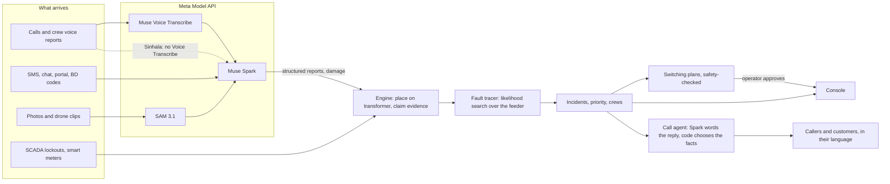

# Relight

**An AI outage agent for electric utilities.** After a storm, Relight reads what people send (calls, SMS and chat in
English, Sinhala, Tamil, Hindi and Spanish; crew voice reports; damage photos and drone clips), finds the failed device
on the grid, plans safe restoration switching, dispatches crews and keeps customers informed. It works with or without
smart meters: where a utility has none, the customers' own complaints are the sensor.

Built solo for the **Meta Global AI Developer Hackathon 2026** (Indie track, theme *Push the Frontier*: understand and
control a physical system).

<!-- DEMO-VIDEO-LINK: add the video link here at submission -->

> **Everything shown is synthetic.** Every customer, address, phone number and account is fictional. Caller and crew
> voices are synthetic (Microsoft edge-tts; Meta has no text-to-speech model). Maps come from OpenStreetMap. Damage
> photos and clips are third-party and credited in the repository.


*The control-room console on the Galle scenario, mid-storm: five open events, the map, the work agenda and the event log.*

## The idea

**Meta models read. Deterministic code locates and decides. The operator approves.**

A model never guesses where a fault is and never approves a switching action. Muse Spark, Muse Voice Transcribe and
SAM 3.1 turn messy human evidence (speech, text, photos, video) into structured facts. A probabilistic tracer then
decides which device opened or which line broke, and a safety-checked planner proposes how to restore power. Every
switching plan waits for the operator.

| Customer portal (`/customer`) | Crew page (`/crew`) |
|---|---|
|  |  |

## How it works



### What each Meta model does

| Model | Job in Relight | Measured |
|---|---|---|
| **Muse Spark** (`muse-spark-1.3`) | Reads every complaint and crew report into a JSON schema (street, house number, symptom, hazard, junk) in five languages. Words the call agent's replies and the dispatcher's explanations. Classifies damage photos and watches drone clips. **Listens to Sinhala calls itself**, because Voice Transcribe has no Sinhala. Reads pole-number plates. | Accuracy below. `reasoning_effort: minimal` cut extraction latency from 4.4 to 2.4 s and Sinhala line wording from 9.9 to 2.8 s. |
| **Muse Voice Transcribe** | Phone calls to text (Tamil, Hindi, Spanish, English), through the file endpoint and a realtime WebSocket line with speaker diarization. The feeder's street names go in as `keywords`. | Street heard right in 11 of 13 clips with keywords against 6 of 13 without. $0.18 per hour of audio. |
| **SAM 3.1** | Outlines poles, wires and fallen trees in photos and tracks them through drone clips. Finds the pole-number plate for Spark to read. Pixel masks (decoded with Meta's `meta-sam-parser`) give pole lean, wire sag and where a fallen tree actually touches the wires. | Temple Road clip: 3 poles and 6 wires followed; the trunk touches 6 of 10 wire tracks by mask. |

The console's **Meta models** panel shows requests, tokens, cost and the share of decisions made by each model, by
code, and by the agent or operator, for the run on screen.

### What deterministic code does

| Step | Where |
|---|---|
| Places each complaint on its service transformer (account, caller ID, address, landmark) | [customers.py](relight/customers.py) |
| Finds which device opened or which line broke: a likelihood search over every protective device, transformer fuse and line, using calls, neighbours' silence, probe answers, meters, SCADA and located damage. Each located device shows the evidence behind it, source by source. | [tracer.py](relight/tracer.py) |
| Asks a customer the question that best separates two explanations; dispatches crews by priority and travel; revises a diagnosis from a crew's report; finds hidden faults after a repair | [engine.py](relight/engine.py), [planner.py](relight/planner.py) |
| Proposes restoration switching (reclose, close a tie, isolate then restore, with several ties) and blocks any plan that would energise a fault, an unconfirmed fault zone or a crew's work zone | [network.py](relight/network.py) |
| Fact-checks every agent line that Spark words: if a number, time, street or id was dropped or changed, the template is spoken instead | [callagent.py](relight/callagent.py) |
| Looks up a pole from its tag, tolerating look-alike characters (O/0, I/1, S/5, B/8) | [poles.py](relight/poles.py) |
| Reads `BD`, `OUT` and `PWR <account>` SMS codes | code only, no model call |

## Results

Eight scenarios run on the same engine. The first three ran against the live Meta Model API and are cached, so replays are
free and identical.

| Scenario | Network | Customers | Messages | Faults found | Dark at the end |
|---|---|---|---|---|---|
| **Galle**, Sri Lanka | IEEE 34-bus feeder over Galle | 1,951 | ~69 | 6 of 6 | 0 |
| **Houston**, USA | OpenStreetMap, smart meters that fail mid-storm | 3,044 | ~221 | 7 of 7 | 0 |
| **Chennai**, India | OpenStreetMap, 2,400 messages in English, Tamil and Hindi | 24,559 | ~2,400 | 9 of 9 | 0 |
| One house dark | one caller; the agent asks a neighbour | 3,044 | ~4 | 1 of 1 | 0 |
| Tree on a line | one lateral, about 160 customers | 3,044 | ~58 | 1 of 1 | 0 |
| Hospital generator | the hospital's backup power fails and it calls | 24,559 | ~215 | 3 of 3 | 0 |
| **Pine Valley**, independent test | IEEE 123-node test feeder, faults from a separate script | 1,658 | 13 | **4 of 5** | **16** |
| Two-tie demo | invented feeder with two ties, one pole down | 229 | 21 | 1 of 1 | 0 |

**What the numbers show**

- **Customer minutes.** Against a first-call-first-served schedule, Relight's priority schedule cuts customer-minutes
  interrupted by 30% in Galle (68,940 against 98,129) and 22% in Houston (107,336 against 137,647). A live wire is made
  safe after 2 minutes instead of 90 in Galle. Across nine settings (fewer or extra crews, delayed reports, faster or slower baseline patrols) the saving ranges
  from 12% to 45% in Galle and 18% to 38% in Houston; the report-delay and patrol settings change only the baseline.
- **A hospital's generator fails.** The call is read in any language by code, the outage jumps the queue, and the
  hospital is restored 64 minutes sooner (01:44 against 02:48).
- **Independent test.** On the published IEEE 123-node feeder, with faults and complaints generated by a separate script
  (fixed seed, no tracer tuning), Relight found 4 of 5 faults and left 16 customers dark; it missed a tree on a lateral
  that never reached the 80% confidence threshold. We report this as measured, not as a pass mark. The network data is
  the IEEE PES test feeder, read from the annotated OpenDSS file in EPRI's OpenDSS distribution (BSD 3-clause, licence in
  [data/IEEE123Master.LICENSE.txt](data/IEEE123Master.LICENSE.txt)).
- **Switching around a fault.** The IEEE data has no sectionalising switches near its ties, so only one safe plan exists
  there. On the two-tie demo (an invented feeder), one pole down has three safe plans (east tie, north tie, both) and the
  planner recommends the one that restores most customers (186 of the 229).
- **Evidence ablation** (mock mode, each source removed in turn). Removing neighbour-probe questions loses 2 of 6 faults in
  Galle and 1 of 7 in Houston. With calls only, 0 of 6 and 2 of 7 faults are found; with SCADA only, 2 of 6 and 1 of 7. Removing
  silence, SCADA, damage photos or smart meters on their own did not change how many faults were found on these storms.
  Calls alone are not enough, and the neighbour question is the one source whose removal costs faults.

**Muse Spark extraction accuracy**, scored against the scenario's labels on the engine's own live readings:

| Scenario | Scored | Street | House no. | Symptom | Hazard | Junk |
|---|---|---|---|---|---|---|
| Galle (en 30, si 11, ta 6) | 47 | 92% | 94% | 92% | 94% | 100% |
| Houston (en 117, es 44) | 161 | 98% | 98% | 99% | 99% | 100% |
| Chennai (en 821, ta 745, hi 126) | 1,692 | 93% | 98% | 97% | 100% | 100% |

Most misses are facts the caller gave only later, or that come from caller ID. Sinhala symptoms are the weakest (82%).
Spark listening to Sinhala still gets digits and place names wrong, so the agent confirms the address by caller ID.

**The fact check.** Of the agent lines Spark worded in the cached runs, none was rejected: Galle 59 lines (English 40,
Sinhala 6, Tamil 13), Houston 142 (English 101, Spanish 41), Chennai 25 (Tamil 9, English 7, Hindi 9). Median wait per
line was 2.0 to 2.9 s.

## Highlights

- **Calls in five languages.** An AI call agent answers every call in the caller's language, warns about hazards,
  escalates live wires and critical customers, and asks a neighbour when the tracer is torn between two explanations.
- **Realtime calls with a human in the loop.** Voiced calls play in real time on a Voice Transcribe realtime line; hard
  calls are handed to a call-taker with a copilot that fills the report live and suggests the next line.
- **Crews report by voice.** The agent reads each report back and nothing changes until the crew confirms. A crew can say
  the transformer is fine and the service wire is down, and Relight changes its diagnosis and replans the work.
- **Photos and drone clips.** SAM 3.1 outlines and tracks poles, wires and fallen trees; Spark reads the damage and the
  pole-number plate, and the pole is named from a register, not guessed.
- **Hidden second faults.** After a restoration, callers who are still dark reveal a fault hidden behind the first.
- **Customers and crews as users.** A customer can check their supply, report a problem or talk to the outage desk by
  voice; a crew has its own page.

## Limits

- Customers, callers and voices are synthetic; real calls are noisier than synthetic speech. The portal call and the
  crew page were tested live with synthetic speech in all five languages, not with a human microphone.
- Only the Sinhala lines were fully checked by a native speaker. For Tamil, Hindi and Spanish only sample lines were.
- Samples are small. The Voice Transcribe keyword test used 13 clips; the Sinhala and Tamil samples in Galle are a
  handful of calls each.
- Lean and wire sag are rough estimates from one camera view, and SAM sometimes tags a traffic-light post as a pole.
- Smart meters are optional and simulated: only Houston has them, and the meter messages are generated, not read from a
  meter data system.
- There is no power-flow model. Relight does not check voltage, current or line capacity, so a plan that uses several
  ties assumes the neighbouring feeder can carry the load.
- Priority weights (for example hospital 400, failed backup power 1,500) are our own choices, not a utility's rules.
- The independent IEEE 123-node test is one synthetic storm run in mock mode, with invented customers and a made-up
  location. It tests the tracer and switching logic on a network shape we did not design; it is not a validation on a
  real utility.

## What's next

Relight runs on a simulated utility today. The next step is a real one: connect to the channels customers already use
(SMS gateway, WhatsApp, web and app messages, phone lines with hand-over to a human), read the utility's own network model
and customer records, test with real callers and photos, and replace our priority rules with the utility's. The
operator keeps approving every switching plan, and the agent never operates equipment. None of this is built; it needs a
utility partner and privacy and security review before any real customer data is used.

## Run it

```bash
python -m venv .venv
.venv/Scripts/pip install -r requirements.txt     # Windows; use .venv/bin/pip elsewhere
cp .env.example .env                               # optional: add MODEL_API_KEY for live Meta models
.venv/Scripts/python -m uvicorn relight.server:app --port 8000
```

Open http://localhost:8000, pick a scenario in the header and press **Run**. The customer portal is at `/customer` and the
crew page at `/crew`. Voice playback needs `ffmpeg` on the PATH.

**Without an API key** the app runs in mock mode: cached model responses are replayed, and anything not cached falls back
to the scenario's labelled ground truth (tagged `mock` in the console). **With a Meta Model API key** (get one at
https://dev.meta.ai), put `MODEL_API_KEY=...` in `.env`; every response is then cached, so replays are free and
repeatable. `.env` is git-ignored.

To replay a scenario without the browser: `python scripts/run_headless.py galle_storm`.

## Built during the hackathon

All code in this repository was written from Oct 29, 2026, during the event. Relight grew out of an idea first explored
in [GridMedic](https://github.com/MalithaBandara/gridmedic), an earlier team project built in Jac with Gemini at the Jaseci
Labs AI Hackathon (17 Oct 2026). Relight is a new project with a new name and codebase; no code from GridMedic is
reused. What is different: it is written from scratch in Python on Meta's models; it has a probabilistic tracer that asks
customers the question that best separates two explanations; feeders are built from real OpenStreetMap roads; and it adds
a call agent in five languages, crew voice reports with read-back, damage assessment from photos and drone clips, and a
console modelled on commercial outage-management work agendas.

## Credits and data

- **Maps:** © OpenStreetMap contributors (ODbL). Feeders for Houston and Chennai run along real streets; real facilities
  appear only under generic names such as "Hospital on <street>".
- **IEEE 123-node test feeder:** IEEE PES Distribution System Analysis Subcommittee; file from EPRI's OpenDSS
  distribution, BSD 3-clause ([licence](data/IEEE123Master.LICENSE.txt)). Customers and street names on it are synthetic.
  The IEEE 34-bus feeder used for Galle is the same family of published test feeders.
- **Photos and clips:** third-party, credited in [media/photos/CREDITS.md](media/photos/CREDITS.md) and
  [media/videos/CREDITS.md](media/videos/CREDITS.md). Two images are AI-generated and labelled as such.
- **Voices:** Microsoft edge-tts, synthetic. **Models:** Muse Spark, Muse Voice Transcribe and SAM 3.1 through the Meta
  Model API; SAM masks decoded with Meta's `meta-sam-parser`.
