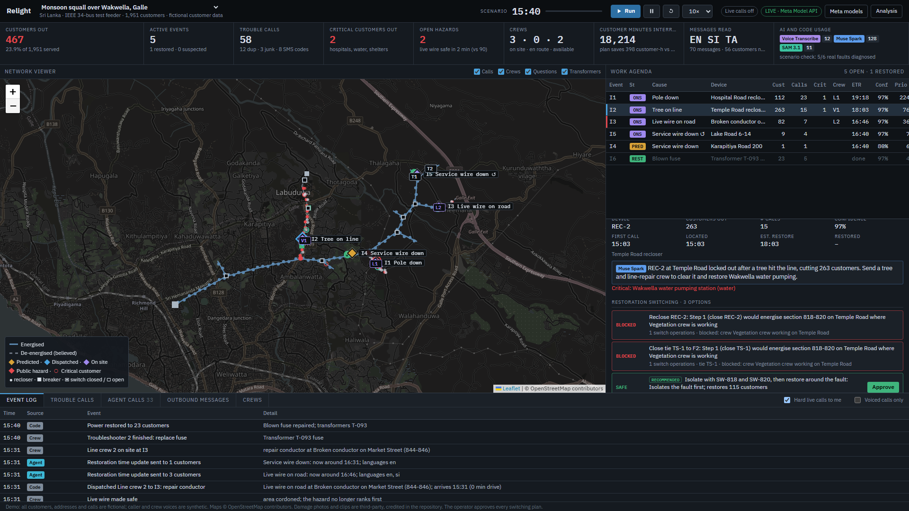
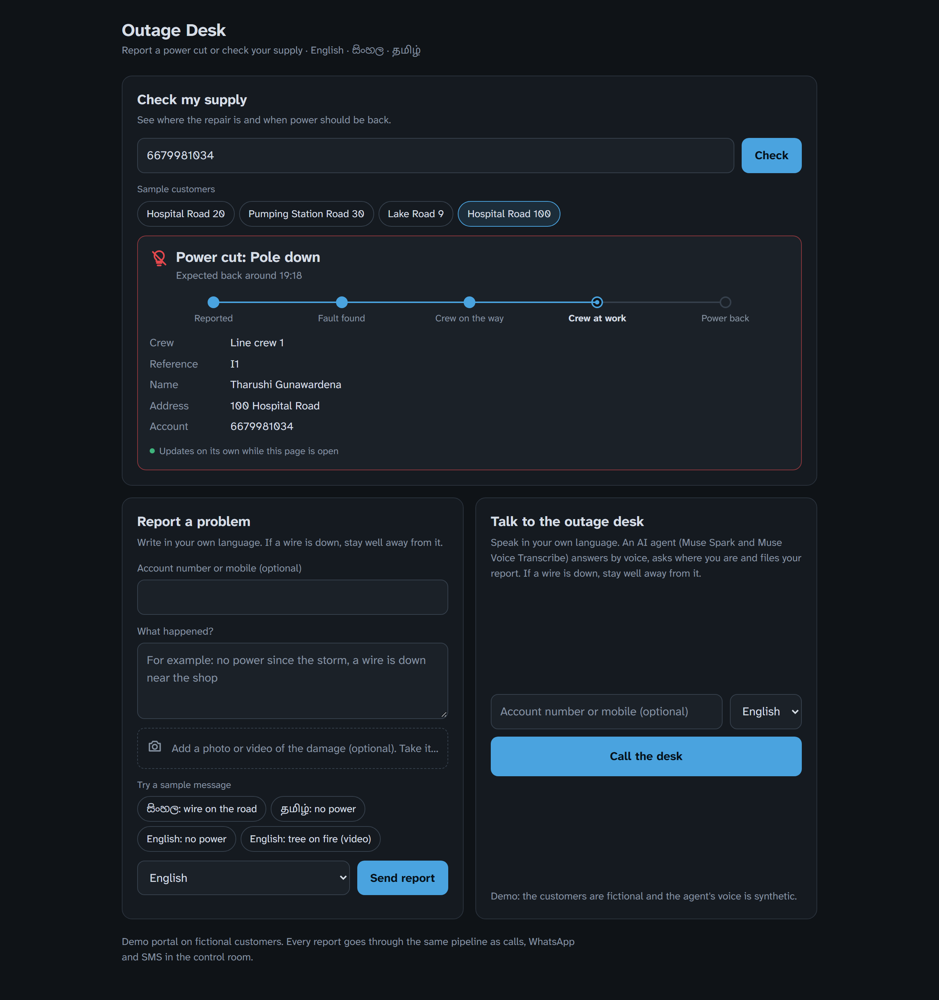
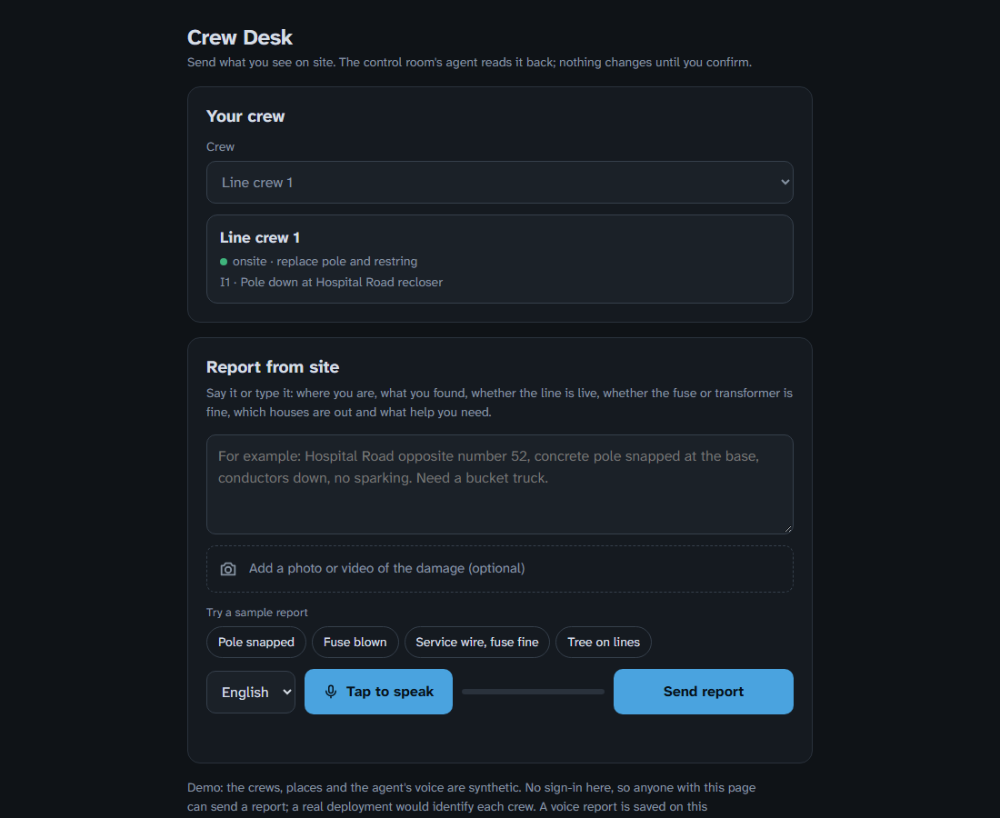
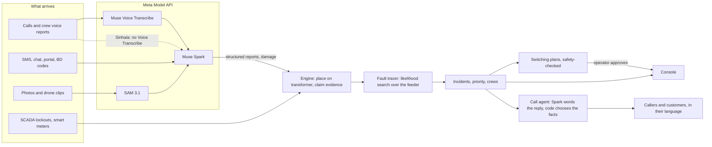

<h1 align="center">Relight</h1>

<p align="center">
  <strong>An AI outage agent for electric utilities.</strong><br>
  Reads what people report after a storm, finds the failed device on the grid, and plans safe restoration.
</p>

<p align="center">
  
  
  
  
  <a href="LICENSE"></a>
</p>

<p align="center">
  <a href="#quick-start">Quick start</a> ·
  <a href="#how-it-works">How it works</a> ·
  <a href="#results">Results</a> ·
  <a href="#limits">Limits</a> ·
  <a href="#development">Development</a>
</p>

<!-- DEMO-VIDEO-LINK: add the video link here at submission -->



<p align="center"><em>The console mid-storm on the Galle scenario, replaying cached live model responses. For the selected event, two switching plans are blocked because a crew is working on the line, and a safe plan waits for the operator to approve it.</em></p>

> [!IMPORTANT]
> **Relight is a prototype and everything shown is synthetic.** It runs on a simulated utility and has not been used by
> a real one. Every customer, address, phone number and account is fictional. Caller and crew voices are synthetic. Maps
> come from OpenStreetMap. Damage photos and clips are third-party and credited in the repository.

## Overview

After a storm, Relight reads what people send (calls, SMS and chat in English, Sinhala, Tamil, Hindi and Spanish; crew
voice reports; damage photos and drone clips), finds the failed device on the grid, plans safe restoration switching,
dispatches crews and keeps customers informed. It works with or without smart meters: where a utility has none, the
customers' own complaints are the sensor.

The design rests on one rule:

**Meta models read. Deterministic code locates and decides. The operator approves.**

A model never guesses where a fault is and never approves a switching action. Muse Spark, Muse Voice Transcribe and
SAM 3.1 turn messy human evidence (speech, text, photos, video) into structured facts. A probabilistic tracer then
decides which device opened or which line broke, and a safety-checked planner proposes how to restore power. Every
switching plan waits for the operator.

Built solo for the **Meta Global AI Developer Hackathon 2026** (Indie track, theme *Push the Frontier*: understand and
control a physical system).

### Highlights

- **Calls in five languages.** An AI call agent answers every call in the caller's language, warns about hazards,
  escalates live wires and critical customers, and asks a neighbour when the tracer is torn between two explanations.
- **Realtime calls with a human in the loop.** Voiced calls play in real time on a Voice Transcribe realtime line; hard
  calls are handed to a call-taker with a copilot that fills the report live and suggests the next line.
- **Crews report by voice.** The agent reads each report back and nothing changes until the crew confirms. A crew can say
  the transformer is fine and the service wire is down, and Relight changes its diagnosis and replans the work.
- **Photos and drone clips.** SAM 3.1 outlines and tracks poles, wires and fallen trees; Spark reads the damage and the
  pole-number plate, and the pole is named from a register, not guessed.
- **Hidden second faults.** After a restoration, callers who are still dark reveal a fault hidden behind the first.
- **Customers and crews as users.** A customer can check their supply, report a problem or talk to the outage desk by
  voice; a crew has its own page.

| Customer portal (`/customer`) | Crew page (`/crew`) |
|---|---|
|  |  |

## Contents

- [Quick start](#quick-start)
- [Usage](#usage)
- [How it works](#how-it-works)
- [Results](#results)
- [Limits](#limits)
- [Configuration](#configuration)
- [HTTP API](#http-api)
- [Development](#development)
- [Troubleshooting](#troubleshooting)
- [What's next](#whats-next)
- [Security](#security)
- [Contributing](#contributing)
- [Built during the hackathon](#built-during-the-hackathon)
- [Credits and data](#credits-and-data)
- [License](#license)

## Quick start

You don't need an API key. The model responses from the live runs are committed in `.cache/`, so a fresh clone replays
them for free.

**Requirements**

| | Needed for |
|---|---|
| Python 3.12 | Everything |
| `ffmpeg` on the PATH | Optional: voice playback (without it, calls show as text) |
| [Meta Model API key](https://dev.meta.ai) | Optional: new model calls, and speech from the portal and crew microphones |

**Install and run** (Windows, PowerShell)

```powershell
git clone https://github.com/MalithaBandara/relight.git
cd relight
python -m venv .venv
.venv\Scripts\pip install -r requirements.txt
.venv\Scripts\python -m uvicorn relight.server:app --port 8000
```

**macOS or Linux**

```bash
git clone https://github.com/MalithaBandara/relight.git
cd relight
python3.12 -m venv .venv
.venv/bin/pip install -r requirements.txt
.venv/bin/python -m uvicorn relight.server:app --port 8000
```

Relight is developed and tested on Windows 11. The macOS and Linux commands are untested.

Open <http://localhost:8000>, pick a scenario in the header and press **Run**.

## Usage

### Pages

| URL | Who it is for |
|---|---|
| <http://localhost:8000> | Operator: map, work agenda, event log, trouble calls, crews, and switching plans to approve |
| <http://localhost:8000/customer> | Customer: check supply, report a problem, talk to the outage desk |
| <http://localhost:8000/crew> | Field crew: say or type a report, attach a photo, confirm the read-back |

### Scenarios

Eight scenarios run on the same engine. Pick one in the console header, or replay it without the browser using its ID.

| ID | What it shows |
|---|---|
| `galle_storm` | The full story: Sinhala, Tamil and English messages, a changed diagnosis, switching around a fault, a hidden fuse |
| `houston_hurricane` | Smart meters that fail mid-storm; English and Spanish |
| `chennai_cyclone` | Scale: about 2,400 messages in English, Tamil and Hindi |
| `house_fuse` | One house dark: one caller, a neighbour asked, a service fault found by elimination |
| `tree_on_line` | One tree on a lateral: about 160 customers, a tree crew then a line crew |
| `hospital_generator` | A hospital's backup generator fails and it calls |
| `ieee123_storm` | Independent test on the IEEE 123-node feeder, with faults from a separate script |
| `two_tie_demo` | Several safe switching plans on an invented feeder with two ties |

### Replay without the browser

```bash
python scripts/run_headless.py galle_storm               # incidents and a check against the scenario's truth
python scripts/run_headless.py galle_storm --timeline    # also print the full event log
python scripts/run_headless.py galle_storm --calls       # also print every voiced call and crew report
python scripts/run_headless.py galle_storm --no-switching
```

Headless runs approve safe switching plans automatically to exercise that path. The server never does: there, the
operator approves every plan. A run ends by printing what is still dark, for example:

```text
What-if customer-minutes: Relight 68,940 vs first-call-first-served 98,129; live wire made safe after 2 vs 90 min
Still dark at the end: 0 customers (believed); world says 0
```

## How it works



### What each Meta model does

| Model | Job in Relight | Measured |
|---|---|---|
| **Muse Spark** (`muse-spark-1.3`) | Reads every complaint and crew report into a JSON schema (street, house number, symptom, hazard, junk) in five languages. Words the call agent's replies and the dispatcher's explanations. Classifies damage photos and watches drone clips. **Listens to Sinhala calls directly from the audio.** Reads pole-number plates. | Accuracy below. `reasoning_effort: minimal` cut extraction latency from 4.4 to 2.4 s and Sinhala line wording from 9.9 to 2.8 s. |
| **Muse Voice Transcribe** | Phone calls to text (Tamil, Hindi, Spanish, English), through the file endpoint and a realtime WebSocket line with speaker diarization. The feeder's street names go in as `keywords`. | Street heard right in 11 of 13 clips with keywords against 6 of 13 without. $0.18 per hour of audio. |
| **SAM 3.1** | Outlines poles, wires and fallen trees in photos and tracks them through drone clips. Finds the pole-number plate for Spark to read. Pixel masks (decoded with Meta's `meta-sam-parser`) give pole lean, wire sag and where a fallen tree actually touches the wires. | Temple Road clip: 3 poles and 6 wires followed; the trunk touches 6 of 10 wire tracks by mask. |

The console's **Meta models** panel shows requests, tokens, cost and the share of decisions made by each model, by
code, and by the agent or operator, for the run on screen.

### What deterministic code does

| Step | Where |
|---|---|
| Places each complaint on its service transformer (account, caller ID, address, landmark) | [customers.py](relight/customers.py) |
| Finds which device opened or which line broke: a likelihood search over every protective device, transformer fuse and line, using calls, neighbours' silence, probe answers, meters, SCADA and located damage. Each located device shows the evidence behind it, source by source. | [tracer.py](relight/tracer.py) |
| Asks a customer the question that best separates two explanations; dispatches crews by priority and travel; revises a diagnosis from a crew's report; finds hidden faults after a repair | [engine.py](relight/engine.py), [planner.py](relight/planner.py) |
| Proposes restoration switching (reclose, close a tie, isolate then restore, with several ties) and blocks any plan that would energise a fault, an unconfirmed fault zone or a crew's work zone | [network.py](relight/network.py) |
| Fact-checks every agent line that Spark words: if a number, time, street or id was dropped or changed, the template is spoken instead | [callagent.py](relight/callagent.py) |
| Looks up a pole from its tag, tolerating look-alike characters (O/0, I/1, S/5, B/8) | [poles.py](relight/poles.py) |
| Texts customers again when their restoration estimate moves by 15 minutes or more, at most once every 30 minutes per event. The message is a fixed template, so a model can't reword the time. | [engine.py](relight/engine.py) |
| Reads `BD`, `OUT` and `PWR <account>` SMS codes | code only, no model call |

## Results

Six of the eight scenarios (Galle, Houston, Chennai, `house_fuse`, `tree_on_line` and `hospital_generator`) ran against
the live Meta Model API, and their responses are committed in `.cache/`, so replays are free. Repeat replays find
the same faults; small details, such as which neighbour is asked, can vary between runs.

| Scenario | Network | Customers | Messages | Faults found | Dark at the end |
|---|---|---|---|---|---|
| **Galle**, Sri Lanka | IEEE 34-bus feeder over Galle | 1,951 | ~69 | 6 of 6 | 0 |
| **Houston**, USA | OpenStreetMap, smart meters that fail mid-storm | 3,044 | ~221 | 7 of 7 | 0 |
| **Chennai**, India | OpenStreetMap, 2,400 messages in English, Tamil and Hindi | 24,559 | ~2,400 | 9 of 9 | 0 |
| One house dark | one caller; the agent asks a neighbour | 3,044 | ~4 | 1 of 1 | 0 |
| Tree on a line | one lateral, about 160 customers | 3,044 | ~58 | 1 of 1 | 0 |
| Hospital generator | the hospital's backup power fails and it calls | 24,559 | ~215 | 3 of 3 | 0 |
| **Pine Valley**, independent test | IEEE 123-node test feeder, faults from a separate script | 1,658 | 13 | **4 of 5** | **16** |
| Two-tie demo | invented feeder with two ties, one pole down | 229 | 21 | 1 of 1 | 0 |

### What the numbers show

- **Customer minutes.** Against a first-call-first-served schedule, Relight's priority schedule cuts customer-minutes
  interrupted by 30% in Galle (68,940 against 98,129) and 22% in Houston (107,336 against 137,647). A live wire is made
  safe after 2 minutes instead of 90 in Galle. Across nine settings (fewer or extra crews, delayed reports, faster or
  slower baseline patrols) the saving ranges from 12% to 45% in Galle and 18% to 38% in Houston; the report-delay and
  patrol settings change only the baseline.
- **A hospital's generator fails.** The call is read in any language by code and adds 1,500 to the outage's priority. On
  the scenario's labelled readings the hospital moves ahead of a larger outage in the tree crew's queue and is restored 64
  minutes sooner (01:44 against 02:48). On the cached live readings the crew goes to the hospital next with or without
  the call, so there the call changes nothing (01:44 both ways).
- **Independent test.** On the published IEEE 123-node feeder, with faults and complaints generated by a separate script
  (fixed seed, no tracer tuning), Relight found 4 of 5 faults and left 16 customers dark; it missed a tree on a lateral
  that never reached the 80% confidence threshold. We report this as measured, not as a pass mark. The network data is
  the IEEE PES test feeder, read from the annotated OpenDSS file in EPRI's OpenDSS distribution (BSD 3-clause, licence in
  [data/IEEE123Master.LICENSE.txt](data/IEEE123Master.LICENSE.txt)).
- **Switching around a fault.** The IEEE data has no sectionalising switches near its ties, so only one safe plan exists
  there. On the two-tie demo (an invented feeder), one pole down has three safe plans (east tie, north tie, both) and the
  planner recommends the one that restores most customers (186 of the 229).
- **Evidence ablation** (mock mode, each source removed in turn). Removing neighbour-probe questions loses 2 of 6 faults in
  Galle and 1 of 7 in Houston. With calls only, 0 of 6 and 2 of 7 faults are found; with SCADA only, 2 of 6 and 1 of 7.
  Removing silence, SCADA, damage photos or smart meters on their own did not change how many faults were found on these
  storms. Calls alone are not enough, and the neighbour question is the one source whose removal costs faults.

### Muse Spark extraction accuracy

Scored against the scenario's labels on the engine's own live readings. Results are in [eval/](eval/).

| Scenario | Scored | Street | House no. | Symptom | Hazard | Junk |
|---|---|---|---|---|---|---|
| Galle (en 30, si 11, ta 6) | 47 | 92% | 94% | 92% | 94% | 100% |
| Houston (en 117, es 44) | 161 | 98% | 98% | 99% | 99% | 100% |
| Chennai (en 821, ta 745, hi 126) | 1,692 | 93% | 98% | 97% | 100% | 100% |

Most misses are facts the caller gave only later, or that come from caller ID; the agent confirms each address with the
caller.

### The fact check

Of the agent lines Spark worded in the cached runs, none was rejected: Galle 59 lines (English 40, Sinhala 6, Tamil 13),
Houston 142 (English 101, Spanish 41), Chennai 25 (Tamil 9, English 7, Hindi 9). Median wait per line was 2.0 to 2.9 s.

## Limits

- Customers, callers and voices are synthetic. The portal call was tested live with synthetic speech in all five
  languages, and the crew page in English, Hindi and Spanish; neither has been tested live with a human microphone. Tamil
  and Sinhala crew reports ran live only as scripted crew calls in the storm scenarios.
- Samples are small. The Voice Transcribe keyword test used 13 clips; the Sinhala and Tamil samples in Galle are a
  handful of calls each.
- Lean and wire sag are estimates from one camera view.
- Smart meters are optional and simulated: only Houston has them, and the meter messages are generated, not read from a
  meter data system.
- There is no power-flow model. Relight does not check voltage, current or line capacity, so a plan that uses several
  ties assumes the neighbouring feeder can carry the load.
- Priority weights (for example hospital 400, failed backup power 1,500) are our own choices, not a utility's rules.
- The independent IEEE 123-node test is one synthetic storm run in mock mode, with invented customers and a made-up
  location. It tests the tracer and switching logic on a network shape we did not design; it is not a validation on a
  real utility.
- The server has no sign-in. Anyone who can reach it can use the operator console and file reports as a crew. See
  [Security](#security).

## Configuration

Settings are read from the environment or from a `.env` file in the repository root. All of them are optional.

```bash
cp .env.example .env    # then add your key
```

| Variable | Default | Purpose |
|---|---|---|
| `MODEL_API_KEY` | empty | Meta Model API key. Get one at <https://dev.meta.ai> |
| `MODEL_MODE` | `live` with a key, otherwise `mock` | `mock` never calls the API |
| `META_API_BASE` | `https://api.meta.ai/v1` | API base URL |
| `SPARK_MODEL` | `muse-spark-1.3` | Muse Spark model |
| `TRANSCRIBE_MODEL` | `muse-voice-transcribe-1.0` | Voice Transcribe model |
| `SAM_MODEL` | `sam-3.1` | SAM model |
| `SPARK_EFFORT` | `minimal` | Spark reasoning effort; `off` sends no effort field |

**Without a key**, the app runs in mock mode: the committed model responses in `.cache/` are replayed (a few requests
differ slightly without a key and are not in the cache), and anything not cached falls back to the scenario's labelled
ground truth, tagged `mock` in the console.

> [!WARNING]
> **With a key**, any request that is not in the cache goes to the API and is billed, then it is cached so later replays
> are free. Changing a prompt changes the cache key, so it sends new requests. A full live run of the largest scenario,
> Chennai, cost about $3. Set `MODEL_MODE=mock` to rule out API calls.

## HTTP API

The server is a FastAPI app, so interactive docs for the REST endpoints are at <http://localhost:8000/docs>. The API has
no versioning and may change.

<details>
<summary>Main endpoints</summary>

| Method | Path | Purpose |
|---|---|---|
| `GET` | `/api/grid` | Feeder GeoJSON, landmarks, crews, customers per transformer, scenario metadata |
| `GET` | `/api/state` | Full engine snapshot |
| `GET` / `POST` | `/api/scenarios`, `/api/scenario` | List scenarios; switch scenario |
| `POST` | `/api/control` | Start, pause, reset or change the replay speed |
| `POST` | `/api/plan` | Operator approves a switching plan |
| `GET` | `/api/customer?q=` | Supply status by account or phone |
| `POST` | `/api/customer/report` | File a customer report |
| `POST` | `/api/customer/call` | Start a call to the outage desk |
| `POST` | `/api/crew/report` | File a crew report; the agent reads it back before it counts |
| `WS` | `/ws` | Snapshot on connect, then live events for the console |

</details>

## Development

### Project layout

```text
relight/     Backend and all logic: engine, tracer, network, planner, call agent, model client, FastAPI server
web/         Console, customer portal and crew page (plain HTML, CSS and JavaScript; no build step)
scenarios/   Scenario definitions; calls/ holds the voiced calls
scripts/     Headless replay, checks, evaluations and generators
tests/       Regression and unit tests
eval/        Saved evaluation results
data/        OpenStreetMap extracts and the IEEE 123-node feeder (customer databases are generated on first use)
media/       Synthetic call audio, photos, overlays and credits
.cache/      Committed model responses, so a keyless clone replays the live runs
```

### Tests

No API key is needed for any of these.

```bash
python -m unittest discover -s tests    # 34 tests with full scenario replays; ~10 minutes on a fresh clone, ~3 after
python scripts/check_offline.py         # fact check, realtime replay, uploads, masks, pole tags; under a minute
```

### Regression baseline

After changing `relight/` or `scenarios/`, the main scenarios must still find every fault and end with everyone restored:

```bash
python scripts/run_headless.py galle_storm          # 6 of 6
python scripts/run_headless.py houston_hurricane    # 7 of 7
python scripts/run_headless.py chennai_cyclone      # 9 of 9
```

The last line of each must read `Still dark at the end: 0 customers (believed); world says 0`.

### Useful scripts

| Script | Purpose |
|---|---|
| `scripts/make_storm.py` | Regenerate storms on OpenStreetMap feeders (fixed seeds) |
| `scripts/make_calls.py` | Synthesise the voiced calls |
| `scripts/fetch_videos.py` | Download the third-party clips (see below) |
| `scripts/ablate.py` | Measure fault finding with each evidence source removed |
| `scripts/sensitivity.py` | Sweep crews, reporting delays and patrol times against the baseline |
| `scripts/eval_extraction.py` | Score Spark's extraction; `--replay` scores cached readings for free |
| `scripts/smoke_test.py` | One small live call per Meta model (needs a key) |

### Third-party clips

The storm clips are not ours to redistribute, so they are not in the repository. Scenarios still replay without them. To
fetch them, with `yt-dlp` installed and `ffmpeg` on the PATH:

```bash
python scripts/fetch_videos.py
```

## Troubleshooting

| Problem | Fix |
|---|---|
| Calls show as text, with no audio | Put `ffmpeg` on the PATH. Agent speech also needs internet access for `edge-tts` |
| The microphone doesn't work on the portal or crew page | Browsers allow it only on `localhost` or HTTPS. Speech also needs a key; without one, type the message |
| Lines tagged `mock` in the console | That request is not in the cache and there is no key, so the scenario's labels were used |
| Lookups don't match the map after changing a network or customer settings | Stop the server, delete the matching `data/*.db` file and restart. It is rebuilt on first use |
| `UnicodeEncodeError` printing Sinhala or Tamil on Windows | Set `PYTHONIOENCODING=utf-8` |
| Python changes have no effect | The commands above run without `--reload`, so restart the server |

## What's next

Relight runs on a simulated utility today. The next step is a real one: connect to the channels customers already use
(SMS gateway, WhatsApp, web and app messages, phone lines with hand-over to a human), read the utility's own network model
and customer records, test with real callers and photos, and replace our priority rules with the utility's. The
operator keeps approving every switching plan, and the agent never operates equipment. None of this is built; it needs a
utility partner and privacy and security review before any real customer data is used.

## Security

Relight is a demo and is not hardened for deployment. It has no sign-in, so run it only on `localhost` or a trusted
network, and never connect it to real customer data or real grid equipment. A real deployment must identify operators
and crews.

Keep your API key in `.env`, which is git-ignored. To report a security problem, open an
[issue](https://github.com/MalithaBandara/relight/issues) without including any secrets.

## Contributing

This is a solo hackathon entry. Bug reports are welcome through
[GitHub Issues](https://github.com/MalithaBandara/relight/issues). Before suggesting a change to the engine, run the
[tests and regression baseline](#development).

## Built during the hackathon

All code in this repository was written from Oct 29, 2026, during the event. Relight grew out of an idea first explored
in [GridMedic](https://github.com/MalithaBandara/gridmedic), an earlier team project built in Jac with Gemini at the Jaseci
Labs AI Hackathon (17 Oct 2026). Relight is a new project with a new name and codebase; no code from GridMedic is
reused. What is different: it is written from scratch in Python on Meta's models; it has a probabilistic tracer that asks
customers the question that best separates two explanations; feeders are built from real OpenStreetMap roads; and it adds
a call agent in five languages, crew voice reports with read-back, damage assessment from photos and drone clips, and a
console modelled on commercial outage-management work agendas.

## Credits and data

- **Maps:** © OpenStreetMap contributors (ODbL). Feeders for Houston and Chennai run along real streets; real facilities
  appear only under generic names such as "Hospital on &lt;street&gt;".
- **IEEE 123-node test feeder:** IEEE PES Distribution System Analysis Subcommittee; file from EPRI's OpenDSS
  distribution, BSD 3-clause ([licence](data/IEEE123Master.LICENSE.txt)). Customers and street names on it are synthetic.
  The IEEE 34-bus feeder used for Galle is the same family of published test feeders.
- **Photos and clips:** third-party, credited in [media/photos/CREDITS.md](media/photos/CREDITS.md) and
  [media/videos/CREDITS.md](media/videos/CREDITS.md). Two images are AI-generated and labelled as such.
- **Voices:** Microsoft edge-tts, synthetic. **Models:** Muse Spark, Muse Voice Transcribe and SAM 3.1 through the Meta
  Model API; SAM masks decoded with Meta's `meta-sam-parser`.

## License

Relight's code is licensed under the [Apache License 2.0](LICENSE). Copyright 2026 Malitha Bandara.

The licence doesn't cover third-party material, which keeps its own terms: OpenStreetMap data (ODbL), the IEEE 123-node
feeder file (BSD 3-clause), photos and clips (see [Credits and data](#credits-and-data)), and Python dependencies,
including `meta-sam-parser` (SAM License). The synthetic voices and cached model responses were produced with third-party
services, whose terms also apply.
