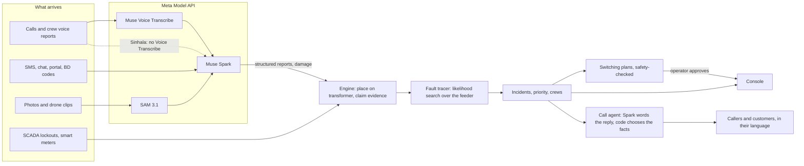

# Relight

An AI outage agent for electric utilities. When a storm hits, Relight reads what people send (calls, SMS and chat in
English, Sinhala, Tamil, Hindi and Spanish; crew voice reports; damage photos and drone clips), finds the failed device
on the grid, plans safe restoration switching, dispatches crews and keeps customers informed. It works with or without
smart meters: where a utility has none, the customers' own complaints are the sensor.

Entry for the Meta Global AI Developer Hackathon 2026, Indie track, theme **Push the Frontier** (energy: understand and
control a physical system).

> **Demo data.** Every customer, address, phone number and account is fictional. Caller and crew voices are synthetic
> (Microsoft edge-tts; Meta has no text-to-speech model). Maps come from OpenStreetMap; the electrical networks are
> generated or are the public IEEE 34-bus test feeder. Damage photos and clips are third-party (credits in `media/`).

**The principle: Meta models read, deterministic code locates and decides.** No model ever guesses where a fault is or
approves a switching action. The operator approves every switching plan.

## Architecture



## Which Meta model does what

| Model | Job in Relight | Measured |
|---|---|---|
| **Muse Spark** (`muse-spark-1.3`) | Reads every complaint and crew report into a JSON schema (street, house number, symptom, hazard, junk) in five languages; words the call agent's replies and the dispatcher's explanations; classifies damage photos and watches drone clips; **listens to Sinhala calls itself** (audio in) because Voice Transcribe has no Sinhala; reads pole-number plates; reads a photographed paper diagram | Extraction accuracy below. `reasoning_effort: minimal` cut extraction latency 4.4 to 2.4 s and Sinhala line wording 9.9 to 2.8 s, with 74-88% fewer output tokens (off by default) |
| **Muse Voice Transcribe** | Phone calls to text (Tamil, Hindi, Spanish, English), file endpoint and a realtime WebSocket line with speaker diarization; the feeder's street names go in as `keywords` | Street heard right in 11 of 13 clips with keywords vs 6 of 13 without. Realtime handshake about 4.7 s with 100 keywords. $0.18 per hour of audio |
| **SAM 3.1** | Outlines poles, wires and fallen trees in photos and tracks them through drone clips; finds the pole-number plate to crop for Spark; pixel masks (decoded with Meta's `meta-sam-parser`) give pole lean, wire sag and where a fallen tree actually touches the wires | Temple Road clip: 3 poles, 6 wires followed, the trunk crosses 4 of 6 (touches 6 of 10 wire tracks by mask) |

The console has a **Meta models** panel (header button, or click the usage card) with requests, tokens, cost and the
share of decisions made by each model, by code, and by the agent or operator, for the run on screen.

## What deterministic code does

| Step | Where |
|---|---|
| Place each complaint on its service transformer (account, caller ID, address, landmark) | [customers.py](relight/customers.py) |
| Which device opened or which line broke: likelihood search over every protective device, transformer fuse and line, with calls, silence, probe answers, meters, SCADA and located damage as evidence | [tracer.py](relight/tracer.py) |
| Ask a customer the question that best separates two explanations | [engine.py](relight/engine.py) |
| Incidents, crews dispatched by priority and travel, diagnosis changes from the crew's site report, hidden faults found after a repair | [engine.py](relight/engine.py), [planner.py](relight/planner.py) |
| Restoration switching (reclose, close the tie, isolate then restore); plans that would energise a fault or a crew's work zone are blocked | [network.py](relight/network.py) |
| Pole-tag lookup (exact, or OCR-tolerant when O/0, I/1, S/5, B/8 folds match one pole), damage placed at that pole | [poles.py](relight/poles.py) |
| Fact check of every agent line Spark words: a number, time, street or id that was dropped or changed sends the template instead | [callagent.py](relight/callagent.py) |
| "BD / OUT / PWR <account>" SMS codes | code only, no model call |

## Results

All three scenarios run end to end on the same engine (`scripts/run_headless.py <scenario>`):

| Scenario | Network | Customers | Messages | Faults found | Dark at the end |
|---|---|---|---|---|---|
| Galle, Sri Lanka | IEEE 34-bus feeder over Galle | 1,951 | ~69 | 6 of 6 | 0 |
| Houston, USA | OpenStreetMap, Spring Branch, smart meters that fail mid-storm | 3,044 | ~221 | 7 of 7 | 0 |
| Chennai, India | OpenStreetMap, Velachery | 24,559 | ~2,400 | 9 of 9 | 0 |

Galle and Houston were run against the live Meta Model API (Galle: 195 calls, 24 minutes, $1.13; both are cached, so
replays are free and identical). Chennai's regression run uses the labelled scenario (marked `mock` in the console)
because a live run takes about 2.5 hours.

**Muse Spark extraction accuracy** against the scenario's labels (`scripts/eval_extraction.py <scenario> --replay`,
scoring the engine's own live readings):

| Scenario | Scored | Street | House no. | Symptom | Hazard | Junk |
|---|---|---|---|---|---|---|
| Galle (en 29, si 11, ta 6) | 46 | 91% | 94% | 94% | 94% | 100% |
| Houston (en 117, es 44) | 161 | 97% | 98% | 99% | 99% | 100% |

Most misses are facts the caller gave only later, or that come from caller ID; Sinhala symptoms are the weakest (82%).
SMS codes need no model and are not scored.

**Voice Transcribe keywords** (`scripts/eval_keywords.py`, only clips where the caller names the street): 11 of 13
right with the feeder's street and landmark names as keywords, 6 of 13 without (Galle 4 to 5 of 5, Houston 1 to 3 of 3,
Chennai 1 to 3 of 5). Small sample, synthetic voices. Each keyword must be 30 characters or fewer, which Meta's docs
do not say and the API answers with HTTP 400; `fit_keywords` handles it. The realtime line uses keywords already;
the engine's file transcription does not yet (adopting them changes every cached request).

**Sinhala.** Voice Transcribe lists 25 languages and not Sinhala. Spark listens instead. Told only "transcribe this", its
Sinhala was near-nonsense; told it is an outage-line call giving a street, a number and what happened, it reads
"Hospital Road ... a pole has fallen". The house number is still sometimes wrong (40 for 47), which is why the agent
confirms the address by caller ID.

## Limits, stated plainly

- Lean and wire sag are rough estimates from one camera view. SAM sometimes tags a traffic-light post as a utility pole.
- Callers are synthetic voices and the customers fictional; real calls are noisier than edge-tts.
- Spark's Sinhala listening still misreads digits and place names.
- Hindi calls and agent wording are tested only in the Chennai mock; Spanish wording was measured in Houston.
- Non-English messages and agent lines have been checked by a native speaker only for Sinhala (in progress).
- HEIC photos are refused (HTTP 415); SAM refuses clips over a few MB, so clips are trimmed small.
- The paper-diagram digitiser is scored but not wired into the engine.

## Built during the hackathon

All code in this repository was written from Oct 29, 2026 onward, during the event.

Relight grew out of an idea first explored in [GridMedic](https://github.com/MalithaBandara/gridmedic), an earlier team
project built in Jac with Gemini at the Jaseci Labs AI Hackathon (17 Oct 2026). Relight is a new project with a new
name and a new codebase; no code from GridMedic is reused. What is different:

- written from scratch in Python, on Meta's models (Muse Spark, Voice Transcribe, SAM 3.1)
- a probabilistic fault tracer that asks customers the question that best separates two explanations
- feeders generated from real OpenStreetMap roads and buildings, and three scenarios
- crew lifecycle with diagnosis changes from site reports, hidden faults found after restoration, and safety-checked
  restoration switching across a tie to a second feeder
- an AI call agent in five languages, realtime calls with a call-taker copilot, crew voice reports with read-back
- damage assessment from photos and drone clips with SAM 3.1 masks, and pole-tag reading
- an outage-management console modelled on commercial OMS work agendas, and a customer portal

## The three scenarios

| Scenario | What it shows |
|---|---|
| Galle | The full story: no smart meters; Sinhala, Tamil and English; BD SMS; a probe question; the agent changing its mind (Lake Road); isolate-and-tie switching (Temple Road); a hidden fuse found after restoration |
| Houston | Smart meters send last-gasp messages until the meter network fails mid-storm; English and Spanish; a hidden fault; a service wire that looks like a blown fuse |
| Chennai | Scale: ~2,400 messages in 30 minutes in English, Tamil and Hindi; PWR SMS codes; re-traced every 15 s |

For Houston and Chennai the line runs along real streets (a shortest-path tree over the road network from the substation),
customers sit in real buildings, and landmarks are real facilities shown under generic names ("Hospital on <street>").
Map data © OpenStreetMap contributors (ODbL), cached in `data/osm/`; refresh with `scripts/fetch_osm.py` and regenerate
the storms with `scripts/make_storm.py`.

## Run it

```bash
python -m venv .venv
.venv/Scripts/pip install -r requirements.txt   # Windows; use .venv/bin/pip elsewhere
cp .env.example .env                             # add MODEL_API_KEY for live Meta models
.venv/Scripts/python -m uvicorn relight.server:app --port 8000
```

Open http://localhost:8000, pick a scenario in the header and press **Run**. The customer portal is at `/customer`.
Voice playback and synthetic callers need `ffmpeg` on the PATH.

Without an API key the app runs in **mock mode**: cached model responses are replayed, and anything not cached falls
back to the scenario's labelled ground truth (tagged `mock` in the UI). With a key, every model response is cached in
`.cache/model/`, so replays are free and repeatable.

**Using your own Meta Model API key:** put it in `.env` as `MODEL_API_KEY=...` (get one at https://dev.meta.ai) and
restart the server. `.env` is git-ignored; never commit it. The author's machine has an extra local switch that holds
back paid calls until the author approves them (`api_allowed` in `relight/config.py`); a fresh clone does not have it
and calls the API normally.

To fetch the third-party example videos (git-ignored): `pip install yt-dlp`, then `python scripts/fetch_videos.py`.

Scripts:

- `scripts/run_headless.py <scenario> [--timeline]`: replay to the end and check against the scenario's ground truth.
- `scripts/check_offline.py`: checks that need no model call (fact check, realtime replay, uploads, masks, pole tags).
- `scripts/smoke_test.py [call.wav] [photo.jpg]`: one small call to each Meta model to check the key.
- `scripts/build_overlays.py`: draw SAM 3.1's outlines over the drone clip and photos from the cached responses
  (poles blue, wires amber, fallen trees red).
- `scripts/eval_keywords.py`, `scripts/eval_extraction.py [scenario] [--replay]`: the measurements above.

## Data

All people, phone numbers and accounts are synthetic. Third-party photos and clips are credited in `media/photos/CREDITS.md`
and `media/videos/CREDITS.md`. Map data © OpenStreetMap contributors (ODbL).
